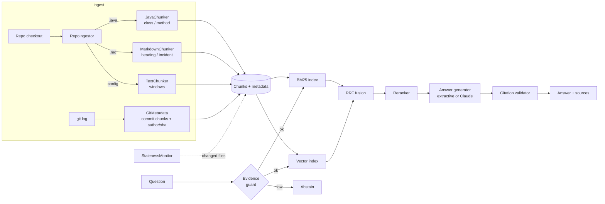

# GitContext

**Ask questions about an unfamiliar codebase and get answers that cite the exact file, method and line range.**

GitContext indexes a Git repository (source code, Markdown docs, incident write-ups and commit history), retrieves with hybrid BM25 + vector search, reranks the candidates and answers with verified citations. When the repository doesn't contain the answer, it says so instead of guessing.

Built with Java 21, Spring Boot 3.5 and Spring AI 1.1. It runs fully offline by default and switches to Claude with one environment variable.

---

## Why it's not "another RAG chatbot"

Most RAG demos never handle the parts that break in production. This project is built around them:

| Failure mode | What GitContext does |
|---|---|
| Arbitrary token chunks split a method in half | **Structure-aware chunking.** Java is split by class and method (a small lexer handles braces inside strings, comments and lambdas), Markdown by heading, and git history by commit |
| Dense search misses exact names and error strings | **Hybrid retrieval.** BM25 with a code-aware tokenizer (`fuseWithRrf` → `fuse`, `rrf`) plus vector search, fused with Reciprocal Rank Fusion |
| First-stage ranking is noisy | **Reranking.** A second stage scores each candidate against the query (rare-term coverage, symbol and path hits, term proximity, exact quoted strings, question intent) |
| The LLM cites sources it was never given | **Citation verification.** Every `[n]` is checked against the context actually sent, and the answer is flagged if it isn't grounded |
| A question about something not in the repo gets a hallucinated answer | **Retrieval-failure guard.** It abstains when keyword coverage plus semantic similarity is too low |
| The index goes stale as code changes | **Incremental re-indexing.** A scheduled job hashes files and re-chunks and re-embeds only the changed, added or deleted ones |
| "It works" with no numbers | **Eval harness and CI gate.** Recall@K, MRR, P@5, citation accuracy, abstention and latency, with a held-out split. CI fails if quality regresses |

## Architecture



## Results

Measured on this repository with `eval/golden.jsonl`: 40 hand-labeled questions (12 identifier lookups, 23 natural-language "how does X work" questions, 5 exact error strings) and 8 out-of-scope questions. Offline configuration: hashing embedder, heuristic reranker, extractive answers.

<!-- RESULTS:START -->
_Run `mvn -q compile exec:java` to regenerate. Full output: [`eval/results/results.md`](eval/results/results.md)._
<!-- RESULTS:END -->

**How to read these numbers**

- **The corpus is small.** It's about 40 files. On a 2,000-file monorepo absolute recall will drop, and the *relative* gains from hybrid retrieval and reranking are the meaningful part.
- **The evaluation guards against tuning to the test.** The reranker weights and the evidence threshold were tuned only while looking at the `dev` half of the questions. The held-out table reports the other half.
- **The offline vector index isn't a neural model.** It uses feature hashing (sub-tokens, character 4-grams and a small concept lexicon), so it has a different error profile from BM25, which is what fusion needs, but it isn't semantic. Plug in a real embedding model (see below) and re-run the eval to quantify the difference.
- **Citation accuracy is the share of cited sources that come from a relevant file.** The extractive answerer cites the top hit plus near-tied neighbours, so this number is capped by precision.

## Quick start

```bash
# 1. Run against any local checkout (defaults to the current directory)
REPO_PATH=/path/to/some/repo mvn spring-boot:run
open http://localhost:8080            # minimal web UI

# 2. Ask over HTTP
curl -s localhost:8080/api/ask -H 'Content-Type: application/json' \
  -d '{"question":"Where are stale files re-indexed?","mode":"HYBRID_RERANK","k":5}' | jq

# Compare retrieval strategies for the same query
curl -s 'localhost:8080/api/search?q=reciprocal%20rank%20fusion&mode=BM25'
curl -s 'localhost:8080/api/search?q=reciprocal%20rank%20fusion&mode=VECTOR'

# Force an incremental refresh (also runs every 60 s)
curl -s -X POST localhost:8080/api/reindex

# 3. Terminal client
mvn -q compile exec:java -Dexec.mainClass=com.saipramod.gitcontext.cli.GitContextCli -Dexec.args="/path/to/repo"

# 4. Docker
docker build -t gitcontext .
docker run -p 8080:8080 -v /path/to/repo:/repo:ro gitcontext
```

### Use Claude for answers

```bash
export LLM_PROVIDER=anthropic
export ANTHROPIC_API_KEY=sk-ant-...
export ANTHROPIC_MODEL=claude-sonnet-5-5   # optional
mvn spring-boot:run
```

The same pipeline then generates answers with Claude through Spring AI's `ChatClient`, using a grounded prompt that treats retrieved code as data rather than instructions. Set `gitcontext.llm-reranker=true` to also use Claude as a listwise reranker. It falls back to the heuristic reranker on any error.

### Use a real embedding model

`SpringAiEmbedder` wraps any Spring AI `EmbeddingModel`. To use one, add a starter (for example `spring-ai-starter-model-openai` or `spring-ai-starter-model-ollama`) and set `spring.ai.model.embedding` accordingly. `AppConfig` picks it up automatically.

## API

| Method | Path | Purpose |
|---|---|---|
| `POST` | `/api/ask` | `{question, k?, mode?}` → answer, `grounded`, `abstained`, sources with commit and author |
| `GET` | `/api/search` | `q`, `k`, `mode`. Raw ranked chunks with their BM25 and vector ranks |
| `POST` | `/api/index` | `{path}`. Full index of a new checkout |
| `POST` | `/api/reindex` | Incremental refresh. Reports changed, added and deleted files |
| `GET` | `/api/stats` | Files, chunks by kind, embedder, reranker |

`mode` is one of `BM25`, `VECTOR`, `HYBRID`, `HYBRID_RERANK` (default).

## Evaluation

```bash
mvn -q compile exec:java                                   # this repo + eval/golden.jsonl
mvn -q compile exec:java -Dexec.args="/path/to/repo my-golden.jsonl out/"
mvn -q compile exec:java -Dcalibrate=true                  # print guard signals per question
```

Golden-set format (one JSON object per line). An empty `relevant` list marks an out-of-scope question:

```json
{"q": "How are stale files detected?", "relevant": ["src/.../CodebaseIndex.java"], "type": "natural"}
```

`EvalGateTest` runs the same evaluation in `mvn verify` and fails the build if Recall@5, MRR or the abstention rates fall below their floors.

## Project layout

```
ingest/    JavaChunker, MarkdownChunker, TextChunker, GitMetadata, RepoIngestor
index/     Tokenizer, Bm25Index, VectorIndex, HashingEmbedder, SpringAiEmbedder
retrieve/  HybridRetriever (RRF), HeuristicReranker, LlmReranker
answer/    ExtractiveAnswerGenerator, LlmAnswerGenerator, CitationValidator
service/   CodebaseIndex (read/write-locked state, incremental reindex), AskService, StalenessMonitor
eval/      EvalRunner (+ eval/golden.jsonl, eval/results/)
```

## Limitations and next steps

- **PR discussions aren't ingested yet.** Commits, docs and incident write-ups are. The next step is a `GitHubPullRequestSource` via the GitHub REST API.
- **The vector index is in-memory, brute-force cosine.** That's fine for repos up to around 50k chunks. `VectorIndex` is the seam for a Qdrant or pgvector adapter.
- **Only Java gets structural chunking.** Other languages fall back to line windows. Tree-sitter would generalize the chunker.
- **The reranker is hand-weighted.** The next step is a cross-encoder (for example `bge-reranker`) served via ONNX, then re-running the eval.

## Resume bullet

> Built GitContext, a Java/Spring AI codebase copilot with structure-aware chunking, hybrid BM25 + vector retrieval (RRF), reranking and citation verification. It reaches **{Recall@5}** Recall@5 and **{MRR}** MRR on a labeled question set at **{p95}** ms p95 retrieval latency, abstains on **{abstain}** of out-of-scope questions, and runs behind a CI quality gate.
